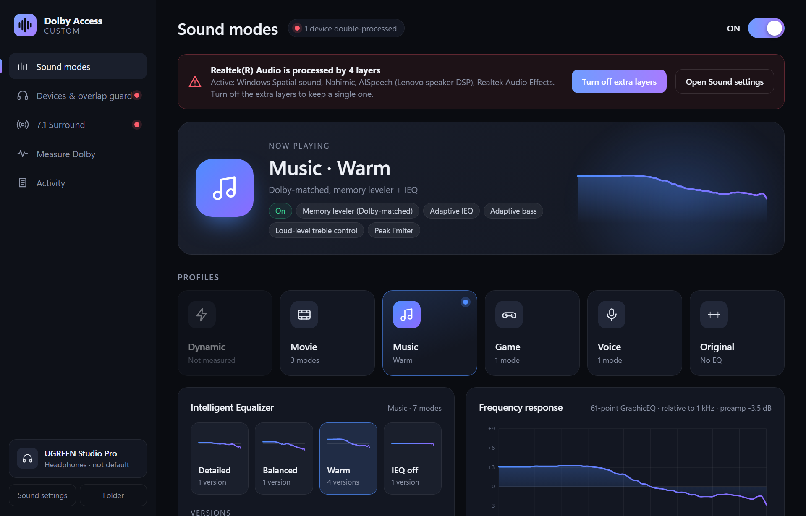
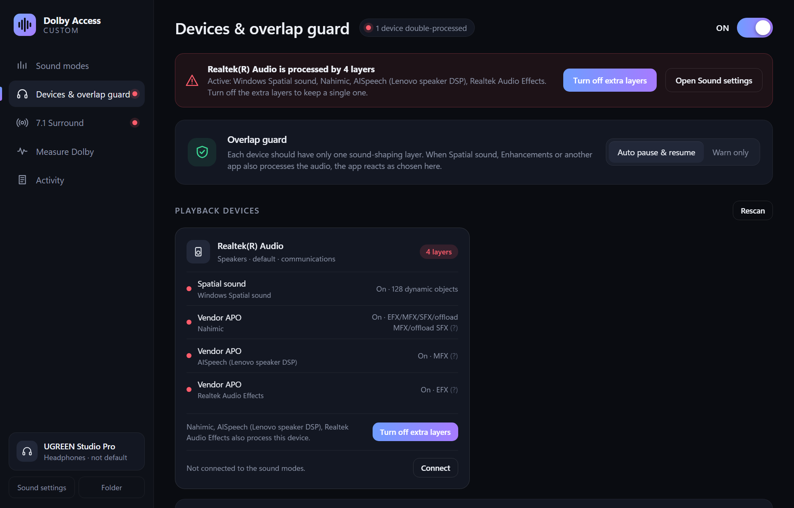
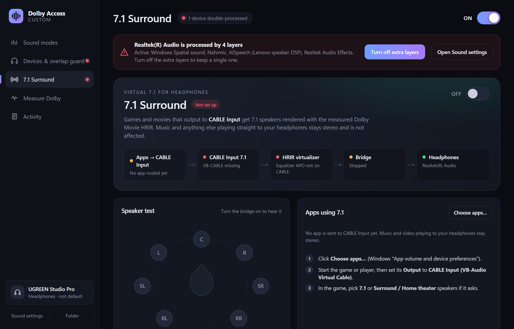

<div align="center">


# Dolby Access Custom

**Dolby Access–style sound modes for any headphones on Windows, with a guard that keeps your audio to a single processing layer.**

[](https://github.com/QuanNH26/Dolby-Access-Custom/releases/latest)
[](https://github.com/QuanNH26/Dolby-Access-Custom/actions/workflows/release.yml)

[](LICENSE)

[Download](https://github.com/QuanNH26/Dolby-Access-Custom/releases/latest) ·
[Features](#features) ·
[How it works](#how-it-works) ·
[FAQ](#faq) ·
[Build from source](#build-from-source)



</div>

## Features

- **Sound modes from real measurements.** Dynamic, Movie, Music, Game and Voice, each with Intelligent EQ variants
  (Detailed / Balanced / Warm / Off), rebuilt from black-box measurements of Dolby Access: EQ curve, Dolby-matched
  volume leveler, adaptive IEQ and bass, peak limiter.
- **Overlap guard.** Detects every layer that shapes a device (Windows Spatial sound, Windows enhancements, vendor APOs
  such as Nahimic, Realtek or Lenovo AISpeech, apps such as FxSound or Voicemeeter) and warns when audio is processed twice.
- **One switch, one layer.** Switching the app on turns the other layers off on your headphones and switching it off puts
  them back exactly as they were. You can also turn them off per device, and stop or start Nahimic.
- **Follows your headphones.** Plug in or pair other headphones and the mode moves to them. Bluetooth Hands-Free (call)
  endpoints are never used.
- **Setup inside the app.** Installs Equalizer APO and HeSuVi and connects Equalizer APO to the device you pick, without
  Device Selector and without a reboot. One Windows admin prompt.
- **7.1 virtual surround** for games and movies through VB-CABLE, using the measured Dolby Movie HRIR, with a speaker test.
- **Measure Dolby yourself.** If Dolby Access is installed, measure any of its modes and add the result to the library.

<p align="center">
  
  
</p>

## Install

1. Download **`DolbyAccessCustom-Setup-<version>.exe`** from the [latest release](https://github.com/QuanNH26/Dolby-Access-Custom/releases/latest).
2. Run it and click through the wizard: accept the license, keep or change the install folder, choose the desktop and
   Start menu shortcuts, then **Install**. It installs for your Windows user (no admin) and opens the app when done.
3. Open the app and click **Set up**, pick your headphones and approve the Windows prompt. Done.

Running a newer Setup updates the app and keeps your settings. Uninstall it from *Settings › Apps*. Before you uninstall,
use **Disconnect** on the *Devices* page if you want your devices back exactly as they were.

Requirements: Windows 10 or 11 (64-bit) and the Microsoft Edge WebView2 runtime, which comes with Windows.

## How it works

```
 apps ──► Windows audio engine ──► Equalizer APO (on the device you picked)
                                       └─ HeSuVi config ─► soundmode.txt  ◄── written by this app
                                                              EQ · leveler · IEQ · limiter of the selected mode
```

- **Engine.** Each mode is a block of Equalizer APO filters (`modes/<id>/mode.txt`). The app writes the active one to
  `HeSuVi\soundmode.txt`, scoped to your headphones' device ID. The On/Off switch flips a single variable, so it takes
  effect immediately.
- **Detection.** It reads each playback endpoint's APO slots (`FxProperties`), Windows Spatial sound state (via a small
  Core Audio helper) and running processes, and builds a list of layers for each device.
- **Connecting a device.** It makes the same registry changes as Equalizer APO's Device Selector (install version 2),
  saves a `.reg` backup first and restarts Windows Audio. **Disconnect** restores the original effects.
- **Portable.** The app runs on its own Python runtime (`runtime\`). Nothing is installed globally apart from Equalizer APO
  and HeSuVi.

## FAQ

<details>
<summary><b>Is this Dolby software?</b></summary>

No. It does not contain or modify any Dolby code. It reproduces how the sound measures, using open-source components
(see the note at the bottom).
</details>

<details>
<summary><b>The app says a device is "processed by N layers". Is something broken?</b></summary>

Not necessarily. Laptop speakers usually come with the maker's own tuning (Nahimic, Realtek, AISpeech…). It only matters
on the device you listen on while the mode is on. Click <b>Turn off extra layers</b> and use <b>Restore</b> to undo it.
</details>

<details>
<summary><b>I switched headphones and the sound did not change.</b></summary>

The first time you use a new pair, click <b>Connect</b> on the yellow notice. After that the mode follows them
automatically.
</details>

<details>
<summary><b>The pinned taskbar icon shows the Python logo.</b></summary>

That pin comes from an older version. Unpin it, open the app and pin it again.
</details>

## Build from source

The repository is the editable project and runs as-is:

```powershell
git clone https://github.com/QuanNH26/Dolby-Access-Custom
cd Dolby-Access-Custom
powershell -ExecutionPolicy Bypass -File build.ps1 -SkipSetup   # launcher + helpers + portable Python (once)
& ".\Dolby Access Custom.exe"                                   # run the app from source
powershell -ExecutionPolicy Bypass -File build.ps1              # also builds dist\DolbyAccessCustom-Setup-<version>.exe
```

To release, bump `VERSION`, add an entry to [CHANGELOG.md](CHANGELOG.md), then push a tag `v<version>`. GitHub Actions builds
the Setup and attaches it to the release. See [CONTRIBUTING.md](CONTRIBUTING.md) for the project layout.

## Credits

- [Equalizer APO](https://sourceforge.net/projects/equalizerapo/) by Jonas Thedering and [HeSuVi](https://sourceforge.net/projects/hesuvi/),
  both GPL. The Setup bundles their official installers unchanged.
- [TDR Nova](https://www.tokyodawn.net/tdr-nova/) by Tokyo Dawn Records (freeware) for the leveler stages.
- [pywebview](https://pywebview.flowrl.com/), NumPy, SciPy and [SoundCard](https://github.com/bastibe/SoundCard).
- [VB-CABLE](https://vb-audio.com/Cable/) by VB-Audio is optional (for 7.1) and is not included.

## License

[MIT](LICENSE) © Hoàng Quân. Third-party components keep their own licenses.

<sub>Dolby, Dolby Access and Dolby Atmos are trademarks of Dolby Laboratories. This project is independent and is not
affiliated with or endorsed by Dolby Laboratories.</sub>
